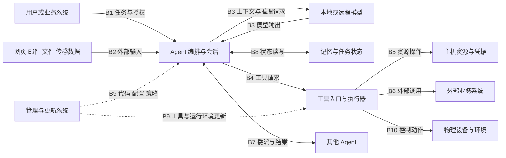

# Agent 运行模型、信任边界与风险建模

版本：v0.1  
日期：2026-10-26  
状态：研究基线，待具体部署验证。本文是分析模型，不是已实施的安全架构或安全保证。

## 1. 研究目标与基本约定

> 后续修正：本版 B1–B10 是功能与信息流参考。当前边界分析以 [运行环境驱动的模型 v0.2](environment-boundaries.md) 为准；风险清单待实际边界确认后重映射。

研究个人计算机、服务器和小型物联网设备上的 Agent 如何安全地接收任务、处理信息、调用工具及影响外部环境。

推导顺序：**运行场景 → 资产与权限 → 信任边界 → 威胁路径 → 风险评估 → 安全设计 → 验证与剩余风险**。

基本约定：

1. Agent 必须依附计算和执行环境；模型、编排程序、工具和执行器可以分布在不同设备或组织中。
2. 模型输出不天然具备授权效力；获得执行效力的具体过程必须被识别。
3. 模块边界、网络边界和信任边界不是同义词。身份、权限、管理主体、可信程度或安全假设发生变化时，需要分析信任边界。
4. 图上存在边界不代表已经隔离。必须记录实际执行机制、旁路及失效条件。
5. IOA、EDR、DLP、沙箱等是可选控制。分别评估基础部署及接入这些能力后的剩余风险，不假定它们必然存在。
6. 本版主要是设计推导，不声称技术创新或覆盖完整性；后续需用具体系统与攻击实验验证。

## 2. 共同运行模型

这是逻辑数据流图，不代表每个框都是独立进程或每条边都跨越网络。B3 在模型同进程部署时可能没有独立隔离；B10 在没有物理执行器的部署中不适用。管理面还可能修改模型、状态、宿主和外部系统，实例化时必须补画。

### 必须记录的实体与资产

| 类别 | 需要盘点的对象 |
|---|---|
| 人与主体 | 用户、管理员、服务身份、设备身份、外部服务方、委派 Agent |
| 数据 | 用户任务、上下文、业务数据、个人信息、模型输入输出、传感数据 |
| 权限与秘密 | 令牌、密钥、登录会话、工具权限、设备控制权限 |
| 代码与配置 | 编排程序、模型制品、Skill、MCP 服务、工具、策略、更新包 |
| 状态 | 长期记忆、任务进度、审批记录、缓存、队列、重试记录 |
| 资源与结果 | CPU、内存、存储、推理费用、业务交易、设备动作、审计证据 |

## 3. 候选信任边界目录

| 编号 | 边界 | 跨越内容 | 核心安全问题 |
|---|---|---|---|
| B1 | 请求方 → Agent | 身份、任务、授权 | 谁可下令？授权是否绑定任务、对象、期限？ |
| B2 | 外部来源 → 上下文 | 文档、网页、邮件、工具返回的内容、传感数据 | 来源和完整性如何确认？数据是否被错误当作命令或授权？ |
| B3 | 编排系统 ↔ 模型 | 上下文、模型输出 | 数据交给谁？模型服务是否可信？输出如何获得执行效力？ |
| B4 | Agent → 工具执行器 | 工具名、参数、执行身份 | 是否符合实际授权？检查与执行是否一致？能否绕过入口？ |
| B5 | 执行环境 → 主机资源 | 文件、进程、内存、凭据、设备接口 | 与宿主共享什么权限？隔离失效后影响多大？ |
| B6 | 本地执行器 → 外部系统 | API、数据、交易 | 接收方是谁？服务端是否独立校验权限？数据流向是否允许？ |
| B7 | Agent ↔ 其他 Agent | 子任务、权限、上下文、结果 | 能否扩大权限？结果是否带来源？失败是否传播？ |
| B8 | 当前执行 ↔ 持久状态 | 记忆、缓存、任务状态 | 谁能写入？污染会持续多久？是否跨用户或跨任务复用？ |
| B9 | 管理与供应链 → 运行系统 | 代码、模型、插件、配置、策略 | 谁能改变可信计算基础？更新是否验证、可回退？ |
| B10 | 数字系统 → 物理环境 | 控制命令、动作反馈 | 是否有独立限值、联锁、停止及失联处置？ |

一个操作可以连续跨越多个边界。例如工具返回的网页先经过 B6，再通过 B2 进入后续推理。不能只检查最初的用户输入。

### 每条实际边界的记录模板

| 字段 | 填写要求 |
|---|---|
| 两侧实体及管理者 | 写明进程、主机、账号、租户或供应商 |
| 身份与权限差异 | 两侧分别能读取、修改、执行什么 |
| 接口和数据方向 | 协议、调用入口、返回值、异步回调 |
| 信任假设 | 明确信任哪一方提供什么保证 |
| 强制执行位置 | 服务端、OS、容器、代理或其他实际机制 |
| 旁路与失效行为 | 直接网络、Shell、共享目录、超时、断网、检查服务失效 |
| 验证证据 | 配置、代码、日志或实验；未知项保留待验证 |

## 4. 三类运行环境的差异

| 维度 | 个人计算机 | 服务器 | 小型物联网设备 |
|---|---|---|---|
| 常见身份 | 交互用户、桌面应用、浏览器会话 | 服务账号、工作负载身份、租户身份 | 设备身份、维护账号、云端控制身份 |
| 关键资产 | 用户文件、登录态、通讯录、本地密钥 | 业务数据、云凭据、生产服务、共享资源 | 固件、设备密钥、传感数据、执行器、安全状态 |
| 高关注边界 | 用户与应用权限、浏览器与本地工具、外部内容与操作 | 租户隔离、服务间访问、队列任务、管理面 | 云与设备、维护接口、传感输入与控制动作、物理接触 |
| 典型暴露面 | 邮件、网页、下载文件、Skill、扩展 | API、上传内容、依赖、镜像、工具服务 | 无线或有线接口、固件更新、调试端口、伪造传感信号 |
| 典型隔离基础 | 用户权限、应用沙箱、OS 访问控制 | 进程、容器、虚拟机、网络及租户权限 | MCU 权限机制或 OS 隔离、硬件保护；能力须逐项确认 |
| 特殊失效模式 | Agent 继承用户全部权限，交互确认疲劳 | 跨租户污染、高并发放大、重试造成重复交易 | 断网、断电、资源不足、物理篡改、动作不可逆 |
| 恢复重点 | 文件版本、会话撤销、操作撤销 | 幂等、交易补偿、凭据吊销、隔离实例 | 安全停机、离线策略、可信恢复、独立保护机制 |

分类不是互斥的：云端 Agent 控制本地设备时，必须同时建模服务器和设备两端。小型设备若没有足够隔离能力，应明确依赖网关或硬件保护，并把该依赖纳入攻击路径。

## 5. 威胁建模方法

以数据流和边界为入口，用 STRIDE 做覆盖检查，再以攻击路径分析组合风险。STRIDE 在此是检查框架，不作为风险评分方法。

| 类别 | 在本模型中的检查示例 |
|---|---|
| 身份伪造 S | 冒充用户、工具服务、子 Agent、设备或授权来源 |
| 篡改 T | 修改上下文、工具参数、记忆、更新包、传感数据 |
| 抵赖 R | 无法还原谁授权、模型提出什么、执行器实际做了什么 |
| 信息泄露 I | 文件、上下文、凭据或跨租户状态流向未授权对象 |
| 拒绝服务 D | 无界循环、任务放大、费用耗尽、设备资源耗尽 |
| 权限提升 E | 越过宿主或服务权限，委派扩大权限，绕过工具入口 |

补充检查：不发生底层提权，也可能违反用户授权。应单独记录“合法身份和接口被用于未授权目的”的路径，避免被传统漏洞清单遗漏。

### 攻击者模型

对每个场景写明攻击者的起点，不默认其已控制整个系统：

- 可提供普通任务或恶意请求的调用者。
- 只能控制网页、文件、邮件或工具返回内容的外部攻击者。
- 可发布或替换 Skill、工具、依赖或更新的供应链攻击者。
- 拥有有限账号权限的内部人员或被攻陷服务。
- 能接触设备、调试接口或传感环境的攻击者。

同时分析非恶意失败：任务歧义、模型错误、过期状态、工具故障、网络中断和重复执行。风险登记中区分攻击与故障，不把所有失败都归因于攻击者。

### 攻击路径示例 R01

1. 攻击者仅能修改 Agent 将读取的外部文档。
2. 文档经 B2 进入上下文，夹带上传本地文件的指令。
3. Agent 提出上传动作，经 B4 调用工具。
4. 工具通过 B5 读取文件，再经 B6 发给攻击者。
5. 风险成立还要求文件可读、出口可达、执行获准且没有有效阻断。

上述前提必须逐项验证。该路径说明沙箱、授权控制、数据流限制可能分别阻断不同环节，不能预先认定某一种措施足够。

## 6. 风险登记与矩阵

结构化清单见 [risk-register.csv](risk-register.csv)。初始条目是待验证假设，不是发现的漏洞；未评分不等于低风险。

每条风险至少记录：部署、资产、攻击者能力、触发条件、边界路径、安全要求、威胁后果、现有控制、证据、可能性、各维影响、控制后评分、责任人与状态。

### 评分约定：初始工作规则

评分针对明确的部署版本、控制配置和评估时间窗。以下采用部署后 12 个月作为初始时间窗；没有证据时填“待评估”，不虚构概率。

| 分值 | 可能性：综合暴露面、前置权限、攻击复杂度和已有控制 |
|---|---|
| 1 | 需要罕见条件或很高前置权限，且有经过验证的有效控制 |
| 2 | 需要多项困难条件，暴露有限 |
| 3 | 存在可行路径，仍需要一定条件或操作 |
| 4 | 暴露广、前置条件少，已有控制较弱 |
| 5 | 常规输入即可稳定触发，或已有重复发生的证据 |

影响分别评估保密性 C、完整性 I、可用性 A、财务与业务 B、物理安全 P；取最大值作为矩阵影响分，保留原始分项。不得用平均值稀释物理安全风险。

| 分值 | 影响锚点：具体金额、停机时长和数据范围待部署负责人定义 |
|---|---|
| 1 | 局部且易恢复，无敏感数据或关键业务影响 |
| 2 | 有限范围损害，可通过常规操作恢复 |
| 3 | 明显数据或业务损害，需要专门处置 |
| 4 | 大范围敏感数据、重大业务中断、重大损失或严重设备损害 |
| 5 | 灾难性业务后果、广泛不可恢复损害或严重人身伤害 |

矩阵分数 = 可能性 × 最大影响。初始分级：1–4 低、5–9 中、10–16 高、17–25 严重。这是排序约定，不是统计概率，也不是自动接受风险的标准。

| 可能性 ↓ / 影响 → | 1 | 2 | 3 | 4 | 5 |
|---|---|---|---|---|---|
| 5 | 中 | 高 | 高 | 严重 | 严重 |
| 4 | 低 | 中 | 高 | 高 | 严重 |
| 3 | 低 | 中 | 中 | 高 | 高 |
| 2 | 低 | 低 | 中 | 中 | 高 |
| 1 | 低 | 低 | 低 | 低 | 中 |

物理安全影响为 4–5，或涉及灾难性不可逆后果的风险，无论乘积分数都进入专门评审，不由该矩阵直接决定可接受性。

“当前风险”按现有控制评分；“剩余风险”在新增控制实现并验证后重评。尚未实施的控制只能记录为预期效果，不能算作已降低风险。

## 7. 从风险推导控制

| 风险机制 | 候选控制 | 必须验证的实际保证 |
|---|---|---|
| 资源越界、宿主暴露 | 最小权限、进程或容器隔离、凭据代理 | 所有实际访问路径是否受限，逃逸和共享资源影响 |
| 外部内容改变授权 | 来源标记、任务授权约束、业务条件校验 | 外部内容能否修改授权，校验是否独立于模型判断 |
| 数据外泄 | 数据访问收敛、出口限制、接收方校验、DLP | 直接网络、浏览器、日志、编码等路径是否覆盖 |
| 委派与状态污染 | 权限收敛、状态分区、来源和有效期 | 子任务能否扩权，污染是否跨会话、跨租户持续 |
| 供应链或管理面失陷 | 更新验证、制品来源校验、管理权限隔离 | 谁可更改策略，如何撤销、恢复和防降级 |
| 资源耗尽与重复操作 | 配额、超时、幂等键、重试约束 | 递归委派是否共享预算，重试是否产生重复副作用 |
| 错误物理动作 | 硬限值、联锁、独立停止机制 | Agent 或网络失效后保护机制是否仍有效 |

设计时为每个控制写明：对应风险、执行位置、可信依赖、旁路、失效行为、验证用例、剩余风险。仅有检测告警，不等于具备阻断能力；需要人工确认的方案还应定义确认者看到什么证据、确认是否绑定具体操作。

## 8. 下一轮工作

1. 选择一个真实部署作为首个实例，补全模型版本、工具列表、运行账号及可访问资源。
2. 用边界记录模板验证 B1–B10，标记适用、不适用和未知项。
3. 为风险清单补充可复现的证据与评分；先统一业务影响的量化锚点。
4. 选取优先风险设计最小控制组合，分别验证没有 IOA 和接入 IOA 时的保证。
5. 比较新增能力与沙箱、权限控制、业务规则的重合程度，再判断研究创新点。

待讨论：首个部署是哪一类？是否可修改 Agent 框架？谁是系统管理员？需要防范到宿主失陷还是以可信宿主为前提？哪些操作不可逆？长任务与无人值守是否在范围内？

## 9. 与已有架构图的关系

[原图](../WechatIMG85.jpg)中的 EDR、零信任网关、EDLP、沙箱、准入和运行时插件，可作为第 7 节的候选控制输入。原图不是边界已落实或风险已消除的证据。本模型先建立资产、权限、攻击路径和评估依据，再决定保留、补充或替换哪些控制。
